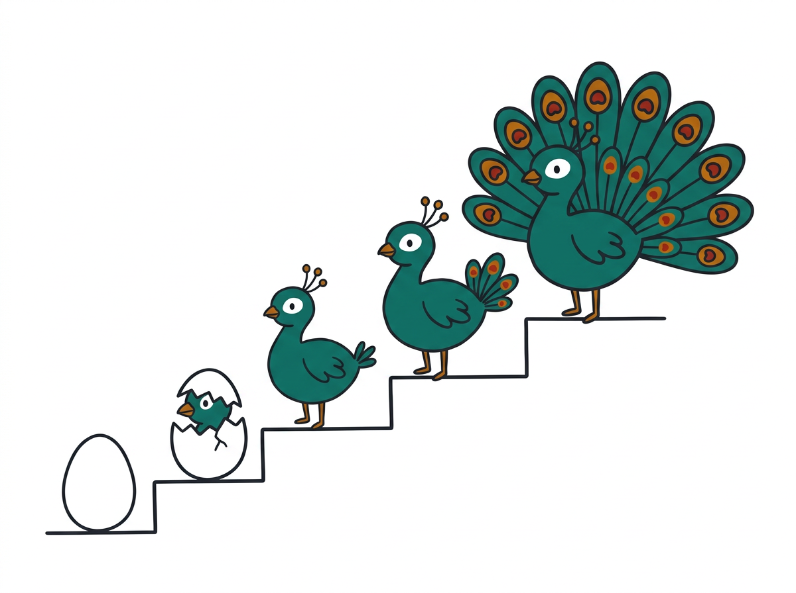

  

<h1 align="center">The peacock that never phoned home</h1>

<em>UbuCon workshop: build a zero-cost AI agent in your browser. 90 minutes including Q&amp;A.</em>

  <strong>Nishant Kumar Thakur</strong> &nbsp;·&nbsp; <strong>Aishwarya Mathuria</strong>

## Getting started

New here? Start with the [pre-workshop setup guide](pre-workshop-guide.md) to install VS Code and Live Server, and to pre-cache the model (a one-time 1.5 GB download, so do it on good wifi). The cache step uses [`exercise/precache.html`](exercise/precache.html).

## Open the workshop

Serve this folder the same way you did for the prework (the browser caches the model per address), then open:

- [`index.html`](index.html): the landing page. Links to the slides, the setup steps and every exercise file. Send attendees here.
- [`slides.html`](slides.html): the deck.
- [`exercise/0-egg.html`](exercise/0-egg.html): where attendees start.

## Exercise files

Each file is where you should be at the end of that chapter. Behind? Open the previous number and carry on.

| File | Chapter | You type |
|---|---|---|
| `0-egg.html` | start | - |
| `1-brain.html` | 1 · load the model | import + `CreateMLCEngine` |
| `2-voice.html` | 2 · chat + streaming | `ask()` |
| `3-character.html` | 3 · system prompt | `system` message |
| `4-memory.html` | 4 · chat history | `chatHistory` |
| `5-face.html` | 5 · chat UI | nothing: read-along. This is the file you customise in chapter 6 |
| `6-yours.html` | 6 · make it yours | name, system prompt, welcome message, colour (a finished example: FitCoach) |
| `7-hands.html` | 7 · tools | nothing: demo and read-along |

`precache.html` downloads the model for anyone who skipped the prework. `style.css` belongs to files 5, 6 and 7.

### What `nest.js` does

It draws the bird, the feather strip and the next quest on every exercise file, and prints WebGPU problems in red.

- **Files 0 to 4:** it awards feathers by reading the request your code sends to the model (`stream: true`, a leading system message, an assistant message in the history).
- **Files 5 to 7:** it is a slim bar above the chat. The face feather lights when the chat appears, and the hands feather when the model first calls a tool.
- **Pills:** every page shows example prompts for the chapter you are on, for instance long-story prompts while you add streaming, and "My name is Mor." then "What's my name?" while you add memory. Clicking a pill fills the chat box, then you press Send.

## Checks

`./check.sh` runs every exercise file against a fake model in headless Chrome and checks the feathers. It does not load the real model.
