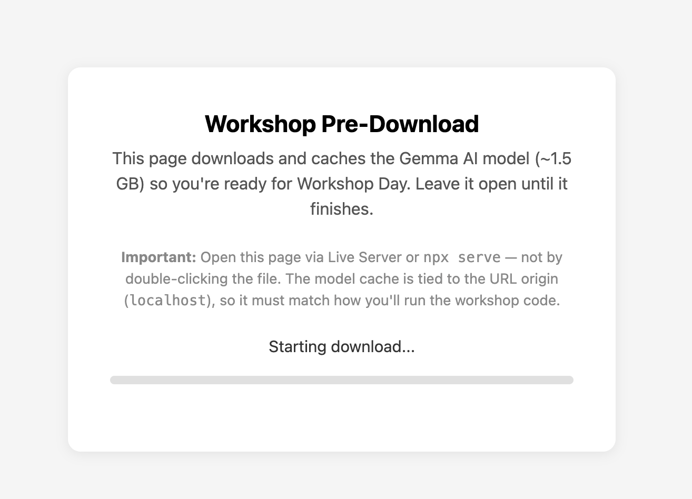
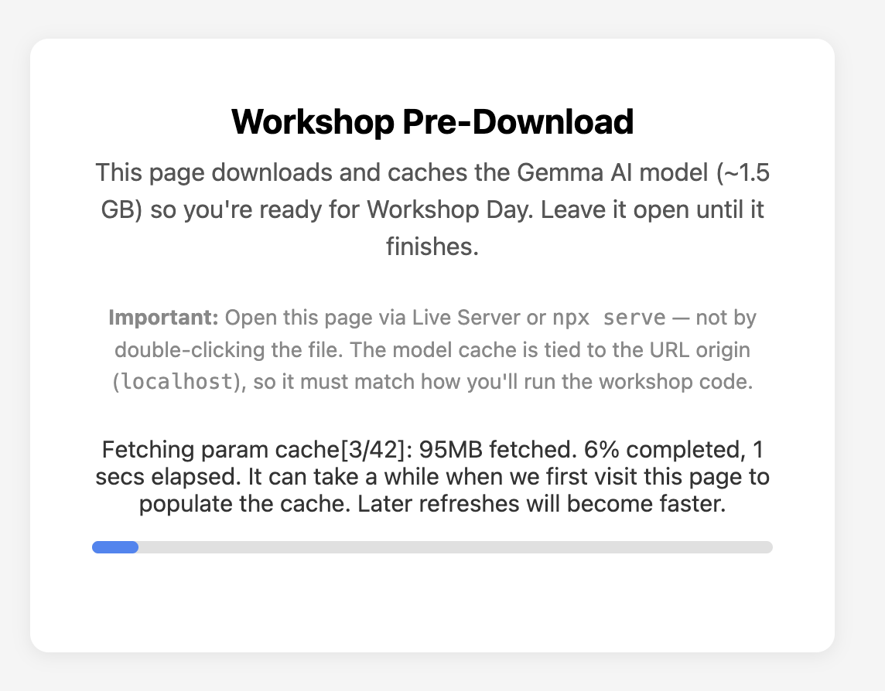
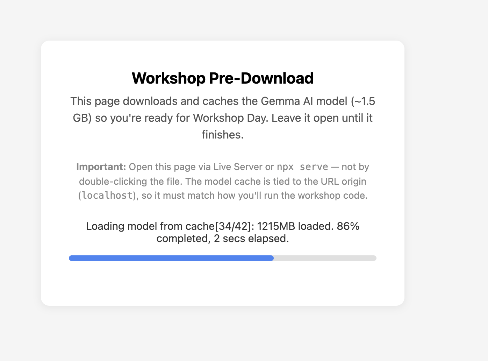
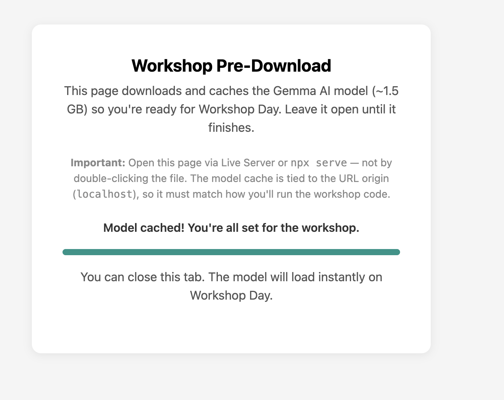

# Pre-workshop setup guide

Do this before UbuCon. It takes about 15 minutes, most of it a one-time 1.5 GB download, so use good wifi.

## What you'll need

1. A laptop with **Google Chrome** installed (latest version)
2. A code editor. We recommend **VS Code** (https://code.visualstudio.com)
3. The AI model pre-downloaded (Step 4)
4. About **5 GB of free disk space** (the model is 1.5 GB, plus browser cache headroom)
5. On the day: your **laptop charger**, and a **phone hotspot** as a wifi fallback

## Checklist

- ☐ VS Code installed
- ☐ Live Server extension installed
- ☐ Chrome shows **WebGPU: Hardware accelerated**
- ☐ Workshop files downloaded and opened in VS Code
- ☐ `precache.html` says **"Model cached!"**

---

## Step 1: Install VS Code and Live Server

1. Download VS Code from https://code.visualstudio.com. On Ubuntu you can also run `sudo snap install code --classic`.
2. Open VS Code.
3. Go to Extensions (the square icon in the left sidebar, or `Ctrl+Shift+X`).
4. Search for **"Live Server"** by Ritwick Dey.
5. Click **Install**.

We use this to run your code in the browser during the workshop.

---

## Step 2: Check your browser supports WebGPU

1. Open **Google Chrome**.
2. Type `chrome://gpu` in the address bar and press Enter.
3. Look for the line **WebGPU: Hardware accelerated**.
4. If you see it, you're good. If not, update Chrome to the latest version and try again.

> **On Ubuntu/Linux?** Chrome often has WebGPU off by default. Open `chrome://flags`, enable **Unsafe WebGPU Support** and **Vulkan**, relaunch Chrome, then recheck `chrome://gpu`.

> **No WebGPU?** Try Microsoft Edge. If neither works, don't worry: we'll help you at the workshop.

---

## Step 3: Download the workshop files

1. Download the files from https://github.com/nkthakur48/peacock-never-phoned-home (click **Code → Download ZIP**), or clone the repo.
2. Unzip it somewhere easy to find, such as your Desktop or Documents.
3. Open the folder in VS Code: **File → Open Folder** and pick the unzipped folder.

You should see an `exercise` folder in the sidebar, with `precache.html` inside it.

---

## Step 4: Pre-download the AI model (about 1.5 GB)

This is the most important step. It downloads the Gemma model into your browser's cache so the workshop starts fast. **Do it on good wifi. It is a one-time 1.5 GB download.**

> **Why Live Server?** The browser caches the model per website address (origin). If you open `precache.html` by double-clicking it, it runs as `file://`, and that cache won't carry over to `localhost` when we run code at the workshop. Opening it with Live Server gives it the same kind of address you'll use on the day.

1. Open the workshop folder in VS Code (from Step 3).
2. Right-click `exercise/precache.html` in the sidebar and choose **Open with Live Server**.
3. Chrome opens automatically and shows a progress bar.
4. **Leave the tab open until it says "Model cached!"** (2 to 10 minutes, depending on your wifi).
5. When it's done you'll see: **"You can close this tab. The model will load instantly on Workshop Day."**

Right after you open it, you'll see:

While it's downloading, the progress bar fills:

If you've already run this before, it loads from the cache instead of downloading again:

When it's finished, the page looks like this:

### Troubleshooting

| Problem | Fix |
|---------|-----|
| Page shows "Download failed" | Use Chrome or Edge, and check that `chrome://gpu` shows WebGPU support. |
| Download is stuck or very slow | Try a faster wifi network, or tether to your phone's data. |
| `chrome://gpu` says WebGPU is disabled | Update Chrome (version 113 or newer is needed). On Linux, see the flags tip in Step 2. |
| Tab crashes | Your laptop may not have enough GPU memory. Tell us at the workshop. |
| "Open with Live Server" is missing | Check that the Live Server extension is installed (Step 1). Or open a terminal in the folder, run `npx serve`, and visit the address it prints. |

### Important

- Do **not** clear your browser cache between now and the workshop.
- At the workshop, open every file with **Live Server from this same folder**, never by double-clicking the HTML file. If you serve the files some other way (a different tool or port), the browser treats it as a different address and downloads the model again.

---

## What to expect

In this 90-minute session you raise your own AI agent from an egg: it gets a brain (the model), a voice (streaming chat), a character, a memory, a face (a chat UI) and hands (tools), then you put it on the internet. No prior AI or machine learning experience is needed. Bring your laptop and your curiosity.

See you there!
